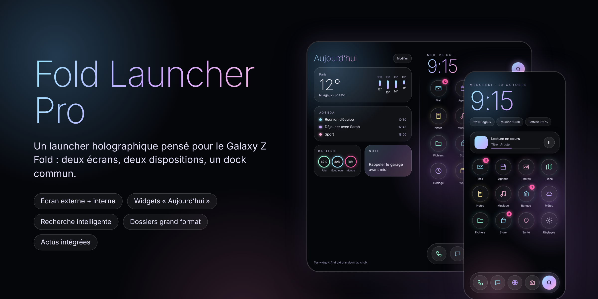
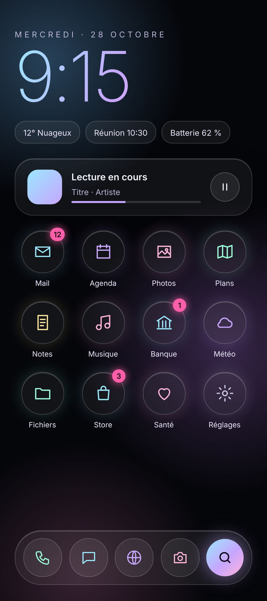
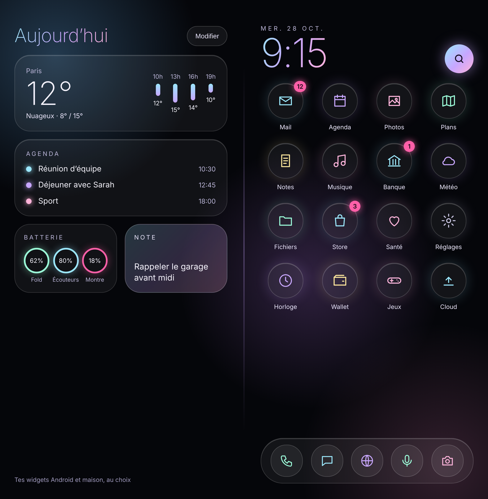
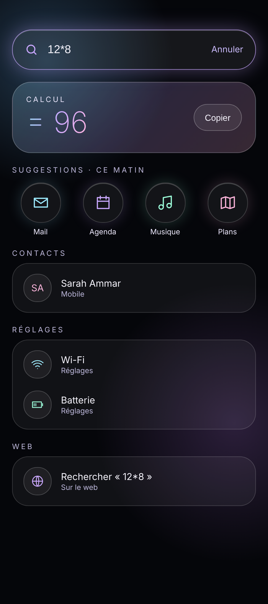
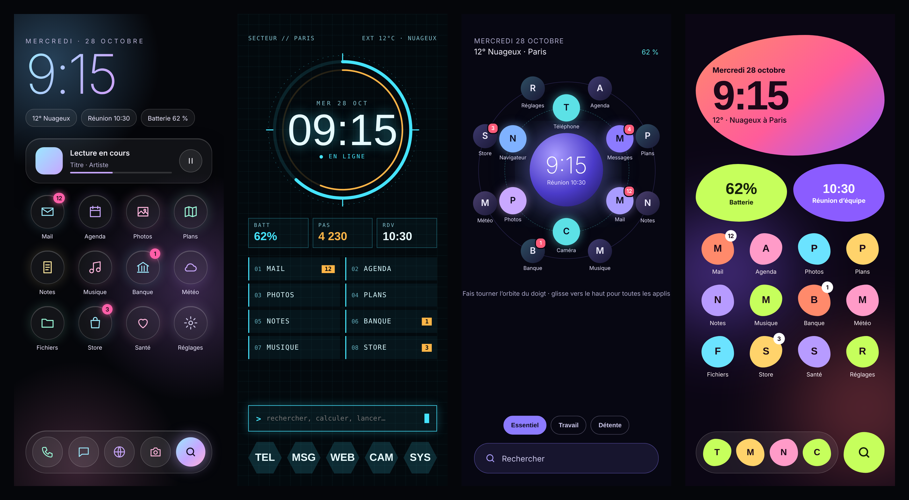

<p align="center">
  
</p>

<h1 align="center">Fold Launcher Pro</h1>

<p align="center">
  <b>Un launcher Android holographique pensé pour le Galaxy Z Fold.</b><br>
  Deux écrans, deux dispositions indépendantes, des widgets « Aujourd’hui », une recherche qui apprend, et tout se règle au doigt.
</p>

<p align="center">
  <a href="https://github.com/yuksel3803/DuoLauncherv2/releases"><b>⬇️ Télécharger le dernier APK</b></a>
  &nbsp;·&nbsp; <a href="CHANGELOG.md">📋 Journal des versions</a>
  &nbsp;·&nbsp; Android 12 et plus &nbsp;·&nbsp; Kotlin + Jetpack Compose
</p>

---

## Sommaire

- [Le concept](#le-concept)
- [Écran externe](#écran-externe)
- [Plier et déplier](#plier-et-déplier)
- [Écran interne](#écran-interne)
- [Recherche](#recherche)
- [Widgets](#widgets)
- [Gestes](#gestes)
- [Personnalisation](#personnalisation)
- [Réglages](#réglages)
- [Mises à jour](#mises-à-jour)
- [Installation](#installation)
- [Compilation et CI](#compilation-et-ci)
- [Limites connues](#limites-connues)
- [Structure du code](#structure-du-code)

---

## Le concept

Un Fold, c’est deux téléphones en un : un écran externe étroit qu’on utilise d’une main, et un grand écran interne presque carré. La plupart des launchers étirent la même grille sur les deux. **Fold Launcher Pro** traite chaque écran séparément :

- une **disposition par écran** (grille, pages, dock), avec la possibilité de copier l’une vers l’autre ;
- un **style holographique** : fond sombre, halos irisés qui bougent doucement, bulles en verre et vraies icônes Android ;
- tout se modifie **directement sur l’écran d’accueil** : appui long, glisser-déposer, sélection multiple, annuler.

<p align="center">
  
  &nbsp;&nbsp;
  
</p>

> Les images sont des maquettes du design holographique, avec des données d’exemple.

---

## Écran externe

- **Horloge et date** en grand, avec des pastilles météo, prochain rendez-vous et batterie.
- **Bouton de recherche à droite de l’horloge** : Google, Finder, la recherche Fold Launcher Pro, ou rien.
- **Lecture en cours** : titre, artiste et bouton pause de la musique qui joue.
- **Grille réglable** (colonnes et lignes), **pages illimitées**, placement libre dans n’importe quelle case.
- **Dock** jusqu’à 5 applis, partagé avec l’écran interne.
- **Pastilles de notifications** sur les icônes.
- **Pas de widgets** ici : l’écran est trop étroit, ils vivent sur l’écran interne.

## Plier et déplier

- **Continuité** : l’autre écran s’ouvre sur la page qui contient les mêmes applis.
- **Écran externe miroir** : replié depuis une page que l’écran externe n’a pas, ses applis s’y affichent quand même.
- **Mode chevalet** : à moitié plié et tourné comme un petit ordinateur, l’heure et la musique en haut, de grosses commandes en bas.

## Écran interne

- **Page « Aujourd’hui »** à gauche : météo, agenda, batterie des appareils, note rapide, rappels, temps d’écran, interrupteurs rapides… et n’importe quel widget Android.
- **Page d’actualités** tout à gauche (remplace Google Discover, que Google ne laisse pas intégrer).
- **Grille indépendante** de celle de l’écran externe, avec ses propres colonnes, lignes et pages.
- **Dock étendu jusqu’à 10 applis**, plus les **applis récentes** affichées automatiquement au bout du dock.
- **Écran partagé** : glisser une appli sur la zone « Écran partagé » l’ouvre à côté de l’appli en cours.

---

## Recherche

<p align="center">
  
</p>

- S’ouvre en **glissant vers le bas** ou avec le bouton à côté de l’horloge ; se ferme en glissant.
- Cherche dans les **applis, les contacts, les réglages et le web**, et fait les **calculs** directement.
- **Elle apprend** : les applis que tu ouvres le plus souvent depuis une recherche remontent en premier.
- **Actions directes** : « minuteur 10 min », « alarme 7h », « rappel pain », « 5 miles en km », « 20 € en dollars » (taux BCE), « appeler Maman », « sms Léa ».
- **Suggestions sous l’horloge** selon la situation : en voiture, casque branché, rendez-vous proche, avant de dormir.
- **Ajout de plusieurs applis d’un coup** sur l’accueil depuis la liste.

---

## Widgets

| Widget | Ce qu’il fait |
| --- | --- |
| Météo | Température, ciel et prévisions des prochaines heures (ville réglable). |
| Agenda | Les prochains rendez-vous du calendrier du téléphone. |
| Batterie | Le téléphone et les appareils Bluetooth connectés (écouteurs, montre). |
| Note | Une note rapide qui se garde d’une session à l’autre. |
| Rappels | Une petite liste de choses à faire, à cocher. |
| Temps d’écran | Le temps passé aujourd’hui et les applis les plus utilisées. |
| Interrupteurs | Lampe, Bluetooth, sonnerie/vibreur, ne pas déranger, rotation (Wi-Fi, données et NFC ouvrent le panneau système). |
| Prochain trajet | Le prochain rendez-vous avec une adresse, et l’itinéraire en un appui. |
| Compte à rebours | Les jours restants avant un événement que tu choisis. |
| Souvenir du jour | Une photo prise à cette date les années précédentes. |
| Widgets Android | N’importe quel widget installé, redimensionnable. |
| Piles | Plusieurs widgets empilés au même endroit, on passe de l’un à l’autre en glissant. |

---

## Gestes

| Geste | Action |
| --- | --- |
| Glisser vers le bas | Recherche (ou panneau de notifications, au choix) |
| Glisser vers le haut | Liste de toutes les applis |
| Double appui | Verrouiller l’écran (réglable) |
| Dessiner une forme | Ouvre l’appli associée (Réglages → Gestes → Dessins) |
| Deux doigts vers le haut / le bas | Action au choix |
| Appui long sur une appli | Menu : raccourcis, renommer, changer d’icône, protéger, infos, stockage, désinstaller |
| Appui long sur le fond | Mode édition : déplacer, sélection multiple, corbeille, ajouter des pages |

Un **guide des gestes** animé s’affiche au premier lancement, et reste accessible dans les réglages.

---

## Personnalisation

- **Styles d’horloge** : fine, grasse, à aiguilles ou en lettres.
- **Météo vivante** sur le fond et **fond d’écran animé** holographique pour l’écran de verrouillage.
- **Coffre secret** ouvert par un geste et l’empreinte, **rangement d’une page** par couleur, catégorie, utilisation ou nom.
- **Réponse rapide** aux messages depuis l’appui long, **dock qui se cache** sur l’écran interne.
- **Palettes de couleurs** : Holographique, couleurs du fond d’écran, Aurore, Océan, Braise, Menthe.
- **Ambiance jour et nuit** automatique et **halos vivants** qui suivent l’heure et la batterie.
- **Effets de changement de page** : Profondeur, Cube, Fondu, Carrousel.
- **Notifications en orbite** autour des icônes, et **pastille « Nouveau »** sur les applis récemment installées.
- **Forme des icônes** : rond, squircle, arrondi, carré, goutte, feuille ou forme d’origine.
- **Packs d’icônes** et icônes **teintées** dans la couleur du thème.
- **Renommer une appli** et lui donner une **icône personnalisée** (image de la galerie).
- **Dossiers grand format** : 1×1, 2×2 ou toute la largeur de l’écran ; un appui sur une appli du dossier l’ouvre directement.
- **Applis protégées** par empreinte ou code.
- **Verrouillage de la disposition** pour ne rien déplacer par erreur.
- **Annuler** la dernière modification.
- **Copier la disposition** d’un écran vers l’autre.
- **Sauvegarde / restauration** de toute la disposition et des réglages dans un fichier JSON.

<details>
<summary>Les autres directions de design explorées (Holographique a été retenu)</summary>

<p align="center"></p>

</details>

---

## Réglages

Les réglages sont organisés en **catégories** avec un **aperçu en direct** de l’écran d’accueil en haut : chaque changement (grille, forme d’icône, étiquettes, dock…) se voit immédiatement.

- **Accueil** : grilles par écran, étiquettes, nouvelles applis ajoutées automatiquement.
- **Dock** : taille du dock externe et interne, nombre d’applis récentes.
- **Apparence** : fond d’écran du téléphone ou fond holographique, parallaxe, halos, forme et pack d’icônes.
- **Gestes** : double appui, deux doigts, glisser vers le bas.
- **Animations** : ouverture holographique des applis ou animation Android, retours haptiques.
- **Batterie** : économie d’énergie automatique sous 20 % (plus de halos animés ni d’effet d’ouverture).
- **Sauvegarde**, **Pastilles de notifications**, **Launcher par défaut**.

---

## Mises à jour

Depuis la build 17, **Fold Launcher Pro se met à jour tout seul** : quand une nouvelle version sort, une fenêtre affiche les nouveautés avec un bouton « Mettre à jour ». Le téléchargement et l’installation se font dans l’appli, et la disposition est conservée.

- Vérification toutes les 6 heures (réglable : 1 h, 6 h ou une fois par jour), sur l’accueil et en arrière-plan avec une notification « Nouvelle version disponible ». « Plus tard » repousse la fenêtre d’une journée, la notification la rouvre.
- Vérification à la main : Réglages → Paramètres → Mises à jour.
- Tout ce qui change à chaque version : **[Journal des versions](CHANGELOG.md)**.

---

## Installation

1. Télécharge le dernier `FoldLauncherPro-N.apk` dans les [releases](https://github.com/yuksel3803/DuoLauncherv2/releases).
2. Ouvre-le sur le téléphone et autorise l’installation depuis cette source.
3. Au premier lancement, l’accueil guidé propose de faire de Fold Launcher Pro le **launcher par défaut** et d’activer les permissions utiles (pastilles, agenda, contacts, position pour la météo).
4. Les nouvelles versions s’installent par-dessus l’ancienne sans perdre la disposition (même signature, même identifiant `com.yuksel.pli`).

**Compatibilité** : Android 12 (API 31) minimum, ciblé Android 16 (API 36). Testé sur Galaxy Z Fold 8, fonctionne aussi sur un téléphone classique (un seul écran).

---

## Compilation et CI

```bash
git clone -b pli https://github.com/yuksel3803/DuoLauncherv2.git
cd DuoLauncherv2
./gradlew :app:assembleRelease
```

Chaque push sur la branche `pli` lance le workflow [`build-pli.yml`](.github/workflows/build-pli.yml), qui :

1. compile l’APK release avec Java 17 et le SDK Android 36 ;
2. le signe avec la clé de mise à jour du dépôt ;
3. publie une release `pli-N` avec le fichier `FoldLauncherPro-N.apk`.

---

## Limites connues

Certaines choses dépendent d’Android ou de One UI et ne peuvent pas être faites par un launcher :

- **Wi-Fi, données mobiles, NFC** : Android interdit aux applis de les basculer ; l’interrupteur ouvre le panneau système.
- **Vider le cache d’une autre appli** : impossible, le menu ouvre la page de stockage de l’appli.
- **Importer la disposition de One UI Home ou d’un autre launcher** : ces données sont privées à chaque launcher.
- **Écran partagé** : dépend de One UI, qui doit accepter l’ouverture côte à côte.
- **Google Discover** : Google ne permet pas de l’intégrer, d’où la page d’actualités maison.
- **Écran verrouillé en ouvrant le Fold** : c’est un réglage Samsung, pas un réglage du launcher.

---

## Structure du code

Tout le code est dans [`app/src/main/java/com/yuksel/pli/`](app/src/main/java/com/yuksel/pli/) :

| Fichier | Rôle |
| --- | --- |
| `MainActivity.kt` | Activité HOME, lancement des applis, écran partagé, sauvegarde. |
| `PliApp.kt` | Racine Compose : choisit la disposition externe ou interne selon la taille d’écran. |
| `Launcher.kt` | État central : applis, disposition, réglages, annuler, économie d’énergie. |
| `Layout.kt` | Modèle de grille : cases, dossiers grand format, pages, dock, déplacements. |
| `HomeGrid.kt`, `Header.kt` | Grille d’accueil, horloge, pastilles et bouton de recherche. |
| `Today.kt`, `Widgets.kt`, `Toggles.kt`, `Productivity.kt` | Page Aujourd’hui et widgets. |
| `Search.kt` | Recherche, apprentissage et ajout multiple d’applis. |
| `News.kt` | Page d’actualités. |
| `Customize.kt`, `CustomIcons.kt`, `IconPacks.kt` | Renommage, icônes personnalisées, packs et formes. |
| `Menus.kt`, `SettingsPanel.kt`, `Onboarding.kt` | Menus, réglages avec aperçu, accueil guidé et guide des gestes. |
| `Holo.kt` | Fond holographique, halos, texte irisé, animation d’ouverture. |
| `Services.kt`, `PliAccessibility.kt` | Pastilles de notifications et verrouillage par geste. |
| `Store.kt` | Enregistrement des réglages, de la disposition et de la note. |
| `Updater.kt` | Mises à jour intégrées : vérification sur GitHub, fenêtre des nouveautés, téléchargement et installation. |
| `Continuity.kt`, `Tabletop.kt` | Continuité au pliage, écran externe miroir, mode chevalet. |
| `Suggestions.kt`, `QuickActions.kt` | Suggestions selon la situation, actions directes de la recherche. |
| `ClockFace.kt`, `WeatherFx.kt`, `HoloWallpaper.kt` | Styles d’horloge, météo vivante, fond d’écran animé. |
| `Vault.kt` | Coffre secret. |
| `Theme.kt`, `Draw.kt`, `NewCards.kt` | Palettes et ambiance, dessiner pour lancer, nouvelles cartes Aujourd’hui. |
| `Perf.kt` | Travail suspendu quand le launcher n’est pas à l’écran (horloge, météo, capteurs). |

> Le nom interne du code reste `pli` (nom de travail du projet) pour que les mises à jour s’installent par-dessus les versions déjà présentes.
